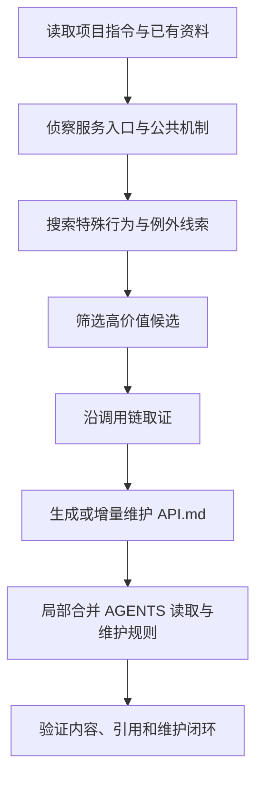

# docs-api 设计方案

`docs-api` 面向能够读取项目源码的 AI 模型：扫描项目，把有助于后续开发、排错和评审的 API 知识写入根目录 `API.md`，并在 `AGENTS.md` 建立按需读取与随任务维护的规则。它不是全量接口手册生成器，不以接口数量、字段表完整度或文档长度作为成功指标。

本方案是维护者参考，说明已确认的定位、取舍与验收方向；日常执行以同目录 `SKILL.md` 为准，不要求模型每次加载本文。方案来自用户明确的目标及 DeepSeek、Gemini、GLM 两轮讨论，模型共识不是行为收益证据。

## 一、交付物与职责

| 文件 | 职责 |
|---|---|
| 项目根目录 `API.md` | 保存高价值 API 知识、适用范围与可定位来源 |
| 项目 `AGENTS.md` | 建立 API 文档的读取条件、更新时机与完成汇报约定 |

自动维护指后续模型在真实任务中读取、核对并必要时更新文档，不安装后台服务、脚本、Hook 或 CI，不新增交付门禁，也不要求后续任务重新调用本 skill。

只要求核对时，两文件均只读，报告差异与建议。生成或维护模式才执行双文件闭环。这里的文件属于使用 skill 的目标项目，不意味着修改技能仓库本身的 AGENTS。

## 二、流程：扫描面广，写入有选择



### 1. 入口与机制侦察

按项目实际协议与结构调查，不将检查项当作必填模板：

- 服务启动、路由注册与挂载、真实前缀、代理重写。
- HTTP、SSE、WebSocket、RPC 等协议入口。
- 鉴权、权限、租户与资源归属的执行位置。
- 响应包装、错误分派、序列化配置。
- 异步任务、回调验签、流式连接、幂等与隐式副作用的线索。
- 现有 OpenAPI、IDL、正式规范及兼容承诺。

扫描项目不等于对每个接口做完整审计。公共机制提供底座，再围绕鉴权豁免、绕过包装、特殊序列化和任务状态等线索寻找候选。未覆盖范围如实说明，不能仅抽查少量接口就声称全项目无例外。

### 2. 知识筛选

每项候选判断三个问题：

1. 是否影响未来模型修改、排错、调用或评审的判断？
2. 是否容易遗漏，或需要跨文件才能可靠重建？
3. 是否已有充分依据，且能明确适用范围？

有助于降低定位成本的少量入口信息可以保留；不为所有模块或接口机械补导航行。稳定性不是硬门槛：重要但易变的事实仍有价值，不过应绑定来源并随变更核对；普通可配置数值优先引用配置符号，避免维护副本。

未知或冲突不能作为确定事实通过筛选，但在会影响修改判断时，可以就近记录其证据边界与待确认问题。

### 3. 深挖与取证

沿路由、处理器、中间件、序列化、业务实现与相关测试核对候选。路径和符号只是定位，不替代实际取证。DTO 类型不独自证明实际 JSON；错误分派器还需追到映射与例外分支；前端 mock 不证明后端保证。

源码与正式规范或发布承诺冲突时，并列说明要求、实现观察和影响，确认后处理，不能简单规定源码永远优先。区分源码核对、测试验证与部署实测，不把提交号当部署版本。

## 三、API.md 的内容取舍

### 优先收录

| 类别 | 示例 |
|---|---|
| 入口与定位关系 | 前缀由多层挂载拼接；关键路由组的注册位置 |
| 公共行为及例外 | 常规响应包装；下载或特定错误绕过包装 |
| 访问与资源边界 | 登录、角色、租户与资源归属分别在哪层检查；哪些入口豁免 |
| 生命周期 | 受理、查询、取消、完成与补偿之间的关系 |
| 副作用与重试 | 重复请求是否新建任务；幂等条件；不能自动重试的情形 |
| 特殊字段语义 | null与省略含义不同；大整数转字符串；验签依赖原始body |
| 兼容约束 | 旧客户端依赖、废弃替代关系、不可随意改变的行为 |
| 关键未知和冲突 | 影响修改但上游实现不可见；正式规范与实现不一致 |

每项知识就近附适用范围和文件路径、符号或可信规范操作入口。章节按实际主题组织，支持按需读取，不固定章节数、条数、行数或独立索引文件。

### 默认不收录

- 常规 CRUD 的全量路径表。
- 可直接查看、没有特殊语义的 DTO 字段抄录。
- 每个接口重复的请求、响应或错误样板。
- 框架常识、通用最佳实践及实现流水账。
- 与 API 判断无关的数据库或 UI 细节。
- 无需复制即可读取的普通配置数值。

这不是一刀切排除字段、路径或示例。它们只有在解释重要行为时才展开。例如错误分支所需的业务码、原始body验签约束和异步入口仍可具体到单接口。

`API.md` 开篇声明它是精选知识，而非完整接口目录。**未收录不代表接口不存在，也不代表已经确认它遵循公共约定。**

已有可信 OpenAPI、IDL 或专题文档时，引用并补充缺失语义，不另建重复真值源；生成物本身不自动代表权威或同步。

## 四、AGENTS 的最小维护闭环

生成或维护模式下，只要 API.md 已存在或本次创建成功，即检查并补齐路由，不以本次是否改写 API.md 为前提；用户明确禁止修改 AGENTS 时只报告缺口，只读核对两文件均不写。复用已有路由表和维护章节，合并同义规则；没有 AGENTS 时最小创建。具体表达遵循项目风格，信息至少包括：文档职责、真实路径、读取条件、更新时机与完成汇报。

```markdown
## API 知识文档

[API.md](API.md) 记录项目 API 的公共机制、例外、非显然业务语义与源码定位，
不是完整接口目录。

- 修改、排查或评审 API、鉴权、响应与错误处理、异步流程前，读取相关章节，
  并沿源码入口核实当前实现。
- 上述行为变化后，核对受影响记录；出现新的高价值知识时，在同一任务中补充。
  普通 CRUD 变更不机械追加接口或字段清单；失效例外应删除，已解决未知应更新。
- 完成时说明 API.md 更新内容，或无需更新及原因。实现与已确认规范或发布承诺
  冲突时，说明差异并确认，不静默以实现覆盖承诺。
```

只维护 API 路由与相关规则，不重排 AGENTS、不调用 docs-agents 盘点八类专题、不复制 API 正文。已有要求与精选知识定位冲突时，指出差异并确认，不自动覆盖项目政策或并列追加矛盾义务；未确认前保留原规则，只给调整建议并报告未完成项。仅当文档实际存在时建立有效路由；文件写入受阻时说明缺口，不声称闭环已建立。

## 五、确认、增量与收缩

- 默认直接扫描并提炼，不再询问“全量字段级还是索引”。用户限制模块时遵守其范围。
- 多服务归属无法判定、正式规范冲突、破坏性替换或迁移已有资料、项目约束阻止写入时，先解决具体疑义。
- 有用的既有详细资料不静默删除或搬迁。根 API.md 已是完整手册时，转换前确认保留方式，不以新定位为由直接覆盖。
- 日常维护只复核受影响知识与共享机制，不每次重扫项目。
- 例外消失后删除过时例外；仍有效的兼容或迁移事实继续保留。未知解决后撤标或转为已核实知识。
- 不刷新未复核章节的验证状态，不追加相互矛盾的“补充说明”。

## 六、实现结构

`SKILL.md` 仅承载执行所需的六部分：定位与边界、扫描、筛选取证、API增量维护、AGENTS局部合并、验证完成。description明确模型知识文档与双文件维护，不再定位为外部联调手册，也不设计参数化双模式。

docs-agents 对该技能的引用名称同步为“API知识文档”。既有评测的取证判据可继续用于局部核对，但新定位还需验证知识筛选与维护闭环；只读评测只能检验建议或草案，不能证明真实写入和幂等性。

## 七、验收场景

| 场景 | 通过标准 |
|---|---|
| 大项目首次生成 | 提炼公共机制、重要例外与定位；无巨型CRUD表；AGENTS补齐有效路由；不问是否全量 |
| 新增常规CRUD | 核对后可不改API.md，说明原因；不机械补行 |
| API.md无需修改但缺维护路由 | 仍检查并补齐AGENTS对应路由；只读模式提供局部草案而不写入 |
| AGENTS已确认全量字段政策 | 识别定位冲突并确认，未确认前保留原政策，不追加矛盾规则 |
| 改鉴权豁免或异步状态 | 同任务同步知识与适用范围，检查共享影响 |
| 特殊行为回归公共约定 | 删除失效例外，保留仍有价值的兼容事实 |
| 连续执行两次 | 无重复章节、重复维护规则或无意义扩写 |
| 文档未收录某接口 | 不推断接口不存在或必然遵循公共约定 |
| 已有完整手册 | 不静默覆盖、删除或迁移，先确认处理方式 |
| 只读核对 | 两文件均不写，报告具体差异、来源与影响 |
| 请求外部全量手册或普通函数参考 | 不把精选知识当作请求产物，不因本skill不适用而拒绝任务 |

先检验实际内容与文件修改，再看报告格式。长期价值另用真实后续任务比较“仅源码／源码加索引／源码加知识文档”，包含陈旧文档和维护成本，不能拿生成任务的表现直接证明后续收益。

## 八、验证状态

本次方案与重写只经过静态一致性和现有评测机制检查，尚未完成新版生成、真实写入、连续执行或未来任务增益实验。历史旧定位的模型运行结果不作为新版效果证明，不建立模型专版或新的脚本系统。
